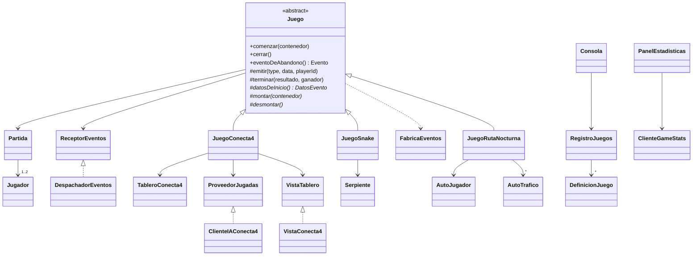

# GameConsole + GameStats

Proyecto 2 del curso de Lenguajes de Programación. **GameConsole** es una consola web con tres videojuegos que se pueden jugar al mismo tiempo, en la misma página o en varias pestañas. Mientras se juega, los juegos le mandan sus eventos a **GameStats** (el Proyecto 1, que vive en este mismo repositorio) y un panel muestra las estadísticas que GameStats calcula, actualizadas en vivo.

| Juego | Tipo | Qué tiene de especial |
|---|---|---|
| **Conecta 4** | Contra la computadora | La computadora decide con **minimax y poda alfa-beta en Prolog** |
| **Culebrita** | Un jugador, en tiempo real | Traducida del proyecto en Java de Omar |
| **Ruta Nocturna** | Un jugador, en tiempo real | Carretera horizontal de noche, 4 carriles, tráfico de frente y turbo |

Conecta 4 y la culebrita se adaptaron de un proyecto anterior propio en Java (Swing): se conservó su lógica y su diseño visual, se quitó el singleton para permitir varias partidas a la vez y la computadora de Conecta 4, que antes jugaba al azar cuando no podía ganar ni tapar, ahora decide en Prolog.

## Inicio rápido (para quien evalúa)

**Lo único que hay que tener instalado es Docker** (Docker Desktop en Windows y macOS).

```powershell
docker compose up --build
```

Cuando termine de arrancar, abrir **http://localhost:8000**. La primera vez tarda varios minutos (descarga imágenes y compila Scala). Para apagar: `Ctrl+C` y `docker compose down`.

Para ver la concurrencia: abrir varias partidas con **Nueva partida**, usar **Abrir en otra pestaña** y mirar el bloque *Instancias ejecutadas* del panel, que cuenta las partidas de todas las pestañas.

| Dirección | Qué es |
|---|---|
| http://localhost:8000 | La consola (nginx), con el panel |
| http://localhost:8080 | GameStats, Go: `POST /events`, `GET /matches`, `GET /instances` |
| http://localhost:8081 | GameStats, Scala: `GET /stats`, `GET /games/{juego}/stats`, `GET /matches/{id}` |
| http://localhost:8082 | IA de Conecta 4 en Prolog: `POST /move` |

Si un puerto está ocupado: `CONSOLE_PORT`, `GO_PORT`, `SCALA_PORT` y `PROLOG_PORT` (por ejemplo, en PowerShell, `$env:CONSOLE_PORT=9000; docker compose up`).

**Desarrollo sin Docker para la consola** (Node 22 o más nuevo): con GameStats y Prolog arriba (`docker compose up go-ingest scala-analytics prolog-ai`), en `console/` correr `npm install` y `npm run dev`, y abrir http://localhost:5173. Vite hace el mismo papel de proxy que nginx.

## Arquitectura

```
                         ┌──────────────── navegador ────────────────┐
                         │  pestaña 1: partidas A, B    pestaña 2: C │
                         └─────────────────────┬─────────────────────┘
                                               │  un solo origen (sin CORS)
                                  ┌────────────▼────────────┐
                                  │  console (nginx, :8000) │
                                  └──┬──────────┬────────┬──┘
                       /api/ingest/  │          │        │ /api/ai/
                    ┌────────────────▼─┐   /api/stats/  ┌▼─────────────────┐
  POST /events ───▶ │ go-ingest (:8080)│        │       │ prolog-ai (:8082)│
  GET /instances    │ valida, agrupa   │        │       │ minimax en       │
                    └───────┬──────────┘        │       │ SWI-Prolog       │
               POST /analyze│ partida completa  │       └──────────────────┘
                    ┌───────▼──────────────────▼┐
                    │ scala-analytics (:8081)   │  GET /stats, /games/{id}/stats
                    │ estadísticas y patrones   │
                    └───────────────────────────┘
```

| Componente | Hace | No hace |
|---|---|---|
| Consola (`console/`, TypeScript) | Ejecuta los juegos, produce y envía los eventos, consulta y muestra las estadísticas | Calcular estadísticas |
| IA (`prolog-ai/`, SWI-Prolog) | Decide la jugada de la computadora en Conecta 4 | Guardar estado: cada pregunta trae el tablero completo |
| GameStats, Go (`go-ingest/`) | Valida, agrupa por partida, cuenta las instancias en vivo | Calcular estadísticas |
| GameStats, Scala (`scala-analytics/`) | Calcula las estadísticas por partida, por juego y generales | Recibir el flujo en bruto |

## Programación orientada a objetos (consola)



- **Herencia y método plantilla:** `Juego` es abstracta. `comenzar()` siempre emite `MATCH_STARTED` y un `PLAYER_JOINED` por jugador y luego monta la vista; cada juego solo completa `datosDeInicio()`, `montar()` y `desmontar()`.
- **Encapsulación:** el estado vive en campos privados (`#tablero`, `#serpiente`, `#vidas`…) y solo se cambia con métodos del juego (`colocarFicha`, `cambiarDireccion`, `cambiarCarril`). Ningún juego puede emitir un evento después de `MATCH_FINISHED`.
- **Abstracción por interfaces:** el juego no sabe a quién le entrega sus eventos (`ReceptorEventos`), quién le da la jugada de la IA (`ProveedorJugadas`) ni cómo se dibuja (`VistaTablero`). En las pruebas se reemplazan por objetos falsos, así que los juegos se prueban sin navegador ni red.
- **Fábrica y registro:** `RegistroJuegos` crea una partida nueva en cada llamada (patrón fábrica). Agregar un juego a la consola es registrar su `DefinicionJuego`.
- **Lógica separada del dibujo:** como en el proyecto de Java (`JuegoSnake` y `VentanaSnake`), cada juego tiene su modelo (`TableroConecta4`, `Serpiente`, `AutoTrafico`) separado de su vista (`<canvas>` o HTML).

## Inteligencia en Prolog

La computadora de Conecta 4 le manda a `prolog-ai` el tablero (42 caracteres) y recibe la columna, el puntaje, cuántos tableros revisó y la razón (`win`, `block` o `minimax`). Prolog primero gana si puede, luego tapa si el rival gana en su próxima jugada, y si no, busca con **minimax (negamax) y poda alfa-beta a 5 jugadas**, evaluando cada tablero con una heurística sobre las 69 ventanas de 4 casillas. La explicación completa está en [`prolog-ai/README.md`](prolog-ai/README.md). La consola muestra debajo del tablero qué decidió Prolog y por qué, y lo manda a GameStats en el evento `AI_DECISION`.

Si Prolog no responde, el juego avisa en pantalla y reintenta cada 2 s: **nunca juega al azar**.

## Eventos y envío concurrente

Los eventos siguen el contrato de GameStats ([`docs/SPEC.md`](docs/SPEC.md), §3 y §14) y se arman en `FabricaEventos`, que revisa antes de enviar lo mismo que revisaría Go (tipo, `playerId` y campos obligatorios) y además lo que Scala no perdona (en `data`, solo textos, números o listas de textos). `eventId` y `matchId` son UUID y el `timestamp` es ISO-8601 en UTC.

**Estrategia de envío (`DespachadorEventos`): una cola por partida, con un solo envío en vuelo por cola, y todas las colas en paralelo.**

- **Por qué una cola por partida:** Go rechaza los eventos que llegan antes de `MATCH_STARTED` o después de `MATCH_FINISHED`. Si los eventos de una misma partida viajaran en paralelo, podrían llegar desordenados. Dentro de una partida se envía en orden y se espera la respuesta.
- **Por qué en paralelo entre partidas:** entre partidas no hay orden que respetar, así que cada cola trabaja por su cuenta y una partida con la red lenta no frena a las demás. Es la misma idea que usa Go del otro lado: una goroutine y un channel por partida.
- **Sin bloquear el juego:** el juego solo encola (`publicar` regresa de inmediato) y sigue.
- **Fallos:** `202` pasa al siguiente. `400` por `eventId` repetido cuenta como enviado (un intento anterior sí llegó y se perdió la respuesta). Otro `400` se registra y se descarta, porque reintentarlo no sirve: Go ya marcó su `eventId` como usado. Un error de red o un `5xx` reintenta **el mismo** evento con espera creciente (0.5 s, 1 s, 2 s… hasta 10 s), sin perder el orden.
- **Partidas que se cierran a medias:** el botón *Cerrar* y el cierre de la pestaña mandan `MATCH_FINISHED` con `result: "ABANDONED"` (al cerrar la pestaña, con `navigator.sendBeacon`). Así ninguna partida queda abierta para siempre en Go.
- **Varias pestañas:** cada pestaña tiene su propio despachador; como los `matchId` son UUID, sus eventos nunca se mezclan.

## Panel de control

A la derecha de la consola. Consulta a GameStats cada 2 segundos (las tres consultas en paralelo; si un servicio falla, lo demás se sigue mostrando) y presenta por separado:

1. **General**, de todos los juegos: `GET /stats` de Scala (`general`).
2. **Instancias ejecutadas, en vivo**: `GET /instances` de Go, por juego (total, en juego, analizadas, fallidas), y la lista de partidas en curso de todas las pestañas (`GET /matches`).
3. **Por juego**, con una pestaña para cada uno: `GET /stats` de Scala (`games`).

Scala solo analiza una partida cuando termina; por eso lo que pasa mientras se juega viene de Go. **La consola no calcula ninguna estadística**: solo traduce el nombre y da formato al valor que llega (hay una prueba que lo verifica). Los cambios que se le hicieron a GameStats para esto respetan su separación: los conteos de instancias en Go (estado de la ingestión) y todos los cálculos en Scala.

## Pruebas

```powershell
cd console          ; npm test                     # 70 pruebas: juegos, eventos, despachador y panel (sin navegador)
cd prolog-ai        ; swipl -g run_tests -t halt tests.pl   # 14 pruebas de la IA (también corren al construir su imagen)
cd go-ingest        ; go test -race ./...          # incluye /instances y la configuración de los juegos nuevos
cd scala-analytics  ; sbt test                     # 41 pruebas, 15 de los juegos nuevos
bash scripts/smoke-consola.sh                      # con todo arriba: prueba de punta a punta por la consola
```

Con Docker, sin instalar nada más: `docker compose run --rm scala-analytics sbt test` para Scala y `docker compose build prolog-ai` para Prolog.

## CI/CD

[`.github/workflows/ci.yml`](.github/workflows/ci.yml), en cada `push` y `pull request`:

1. **Go**, **Scala**, **consola** (`npm ci`, `npm test`, `npm run build`) y **Prolog** (plunit), en paralelo.
2. **Docker:** construye las imágenes, levanta los 4 servicios, corre el simulador del Proyecto 1 y luego `scripts/smoke-consola.sh`, que manda una partida de cada juego nuevo **a través de la consola**, le pide una jugada a Prolog y comprueba que Go las cuenta y Scala las analiza.
3. **CD (solo en `master` y `proyecto2`):** publica las 4 imágenes en GitHub Container Registry (`ghcr.io/omaru07/gamestats-*`, con las etiquetas `latest` y el commit).

## Deployment

Mismo enfoque que el Proyecto 1, ahora con dos formas:

- **Construyendo en la máquina:** `docker compose up --build` (todo el sistema, validado por el CI en cada cambio).
- **Con las imágenes publicadas por el CD**, sin compilar nada, en cualquier servidor con Docker:
  ```bash
  docker compose -f docker-compose.deploy.yml pull
  docker compose -f docker-compose.deploy.yml up -d
  ```
  Solo queda expuesta la consola (puerto 8000); Go, Scala y Prolog se hablan por la red interna de Docker. Se reinician solos si se caen.

## Decisiones y límites conocidos

- **TypeScript sin framework:** los juegos son clases puras y la orientación a objetos queda a la vista; Vite solo compila.
- **Prolog como servicio HTTP aparte**, igual que Go y Scala: se prueba solo, se reemplaza sin tocar la consola y cada petición la atiende un hilo distinto (varias partidas piden jugada a la vez sin mezclarse).
- **Profundidad 5 en Conecta 4:** juega bien y responde rápido (el tiempo real se ve en el panel, en *La IA piensa en promedio*); más profundidad haría esperar a la persona.
- **Polling cada 2 s** en el panel en vez de WebSocket: GameStats no tiene notificaciones y agregarlas habría cambiado su arquitectura. Para un panel que se mira mientras se juega, 2 s es suficiente.
- **Ruta Nocturna es un juego original:** toma la mecánica clásica de los juegos retro de manejar de noche (carretera horizontal, tráfico de frente, cambiar de carril), con arte y nombres propios.
- **Estado en memoria**, como en el Proyecto 1: al reiniciar GameStats se pierden las estadísticas (los resultados de Scala quedan además en `output/`).
- **El teclado** de la culebrita y Ruta Nocturna solo llega a la partida que tiene el foco (clic en su tablero), para que varias partidas en pantalla no se muevan juntas.

## Estructura del repositorio

```
gamestats/
├── console/              # Proyecto 2: consola web (TypeScript + Vite; nginx en Docker)
│   └── src/
│       ├── core/         # Juego (abstracta), Partida, Jugador, RegistroJuegos
│       ├── events/       # contrato, FabricaEventos, DespachadorEventos
│       ├── games/        # conecta4/, snake/, rutanocturna/ y el catálogo
│       ├── consola/      # la interfaz de la consola
│       └── panel/        # panel de estadísticas
├── prolog-ai/            # Proyecto 2: IA de Conecta 4 en SWI-Prolog
├── scripts/              # smoke test de la consola
├── docker-compose.yml          # todo el sistema, construyendo las imágenes
├── docker-compose.deploy.yml   # despliegue con las imágenes publicadas por el CD
├── games/                # configuración de juegos para Go (5 juegos)
├── go-ingest/            # GameStats: Go
├── scala-analytics/      # GameStats: Scala
├── simulator/            # simulador del Proyecto 1
└── docs/                 # SPEC.md y un evento de ejemplo de cada tipo
```

## Video de demostración

**Link:** _(pendiente: agregar aquí el link público del video)_

---

## Proyecto 1: GameStats

> Lo que sigue es el README del Proyecto 1, sin cambios de fondo. Los comandos siguen funcionando; desde el Proyecto 2, `docker compose up --build` también levanta la IA de Prolog y la consola.

Sistema que recibe eventos de partidas de videojuegos (simulados), los agrupa por partida y produce estadísticas y patrones. Proyecto del curso de Lenguajes de Programación.

- **Go** (paradigma imperativo): recibe, valida y agrupa los eventos con goroutines y channels. No calcula estadísticas.
- **Scala** (paradigma funcional): analiza cada partida con transformaciones de colecciones (`filter`, `groupMapReduce`, `foldLeft`, `partition`…), detecta patrones y expone los resultados.
- Los dos son **servicios independientes** que se comunican por **HTTP/REST con JSON**.
- Juegos incluidos: **carreras** (`racing`) y **combate** (`combat`). Agregar un juego no obliga a reescribir el sistema (ver [Cómo agregar un juego](#cómo-agregar-un-juego)).

### Inicio rápido (para quien evalúa)

**Lo único que hay que tener instalado es Docker** (Docker Desktop en Windows y macOS; Docker Engine con Compose en Linux). No hace falta instalar Go, Scala ni sbt: todo se descarga y se compila dentro de las imágenes.

```powershell
# Terminal 1: construir y arrancar Go y Scala
docker compose up --build

# Terminal 2 (cuando la 1 diga "Go escuchando en el puerto 8080" y "Scala responde OK"):
docker compose run --rm simulator

# Al terminar, en la terminal 1: Ctrl+C y luego
docker compose down
```

- **La primera vez tarda entre 5 y 10 minutos** (descarga imágenes, sbt y las librerías de Scala) y **necesita internet**. Las siguientes veces arranca en segundos.
- El simulador imprime: (1) la ingestión, con los eventos aceptados y los inválidos rechazados a propósito, y (2) **al final, lo que Scala analizó**: el ganador y los patrones (racha, remontada) de cada partida.
- Para ver una partida completa: `curl http://localhost:8081/matches/combat-001` (en PowerShell, `curl.exe`) o abrir los archivos de `output/`.

Si algo no arranca, ver [Problemas frecuentes](#problemas-frecuentes).

### Arquitectura

```
┌───────────┐  POST /events   ┌──────────────┐  POST /analyze  ┌──────────────────┐
│ Simulador │ ──────────────▶ │  Go (8080)   │ ──────────────▶ │  Scala (8081)    │
│  (Go)     │   un evento     │ valida,      │  partida        │ estadísticas +   │
│ varias    │   a la vez, en  │ agrupa por   │  completa       │ patrones         │
│ partidas  │   paralelo      │ partida      │  (JSON)         │ GET /matches ... │
└───────────┘                 └──────────────┘                 └──────────────────┘
```

| Componente | Hace | No hace |
|---|---|---|
| Simulador (`simulator/`) | Genera eventos de varias partidas y juegos en paralelo, incluidos casos especiales e inválidos | Validar ni analizar |
| Go (`go-ingest/`) | Recibe, valida, rechaza y registra inválidos, agrupa por partida, y envía la partida terminada a Scala | Calcular estadísticas |
| Scala (`scala-analytics/`) | Lee la partida, calcula estadísticas, detecta patrones, guarda y expone resultados | Recibir el flujo en bruto ni validar la estructura básica |

### Requisitos

- **Para ejecutar el sistema:** solo [Docker Desktop](https://www.docker.com/products/docker-desktop/) (incluye Docker Compose) y conexión a internet la primera vez. Las imágenes funcionan en procesadores Intel/AMD y ARM (Apple Silicon).
- **Para desarrollar sin Docker:** Go 1.26+, JDK 17+ y sbt 2.0.x. Versiones usadas: Go 1.26.5, JDK 25 (21 dentro de Docker), sbt 2.0.9, Scala 3.3.7, Cask 0.11.3.

### Instalación y ejecución (Docker)

Desde la raíz del repositorio:

```powershell
# 1. Construir y arrancar Go y Scala (la primera vez tarda varios minutos)
docker compose up --build

# 2. En OTRA terminal: enviar las partidas simuladas (semilla fija 42); al final muestra el análisis de Scala
docker compose run --rm simulator

# 3. Consultar resultados
curl.exe http://localhost:8080/matches                  # estado de las partidas en Go
curl.exe http://localhost:8081/matches                  # resultados en Scala
curl.exe http://localhost:8081/matches/combat-001       # una partida completa

# 4. Apagar
docker compose down
```

En PowerShell se usa `curl.exe` (en Linux/macOS, `curl`). Los resultados también se escriben como archivos JSON en `./output/<matchId>.json`.

Opciones del simulador (se pasan después del nombre del servicio):

```powershell
docker compose run --rm simulator -seed 7 -prefix r2-   # otra simulación, sin chocar con los matchId anteriores
docker compose run --rm simulator -racing 5 -combat 2   # otra cantidad de partidas
```

Otras opciones: `-pause` (pausa máxima entre eventos en ms), `-scala` (dirección de Scala para mostrar el análisis al final; dentro de Docker ya viene configurada) y `-dry` (solo imprime los eventos, sin enviarlos).

Los puertos son **8080** (Go) y **8081** (Scala). Dentro de Docker, Go llega a Scala por el nombre del servicio (`http://scala-analytics:8081`), no por `localhost`.

### Problemas frecuentes

| Síntoma | Causa y solución |
|---|---|
| `Cannot connect to the Docker daemon` / `error during connect` | Docker Desktop no está abierto. Ábrelo, espera a que termine de iniciar y repite |
| `port is already allocated` (8080 u 8081) | Otro programa usa ese puerto. Ciérralo, o usa otros: PowerShell `$env:GO_PORT=8090; $env:SCALA_PORT=8091; docker compose up` — Linux/macOS `GO_PORT=8090 SCALA_PORT=8091 docker compose up`. Luego las consultas usan esos puertos. El simulador no cambia |
| El primer `docker compose up --build` parece detenido | Es normal: Scala descarga y compila sus dependencias (5 a 10 min la primera vez) |
| El simulador dice `no pude conectar con Go` | Falta esperar a que la terminal 1 muestre `Go escuchando en el puerto 8080` |
| Al repetir el simulador salen rechazos de `matchId` repetido | Go y Scala guardan las partidas en memoria. Reinicia con `docker compose down` y `up`, o usa `docker compose run --rm simulator -prefix r2-` |
| `curl` no funciona en PowerShell | Usa `curl.exe` (en PowerShell `curl` es otro comando) |

### Ejecución sin Docker (desarrollo)

Tres terminales, en este orden:

```powershell
cd scala-analytics ; sbt run          # 1. Scala (puerto 8081)
cd go-ingest       ; go run .         # 2. Go (puerto 8080); debe decir "Scala responde OK"
cd simulator       ; go run . -seed 42 -scala http://localhost:8081   # 3. Simulador (muestra el análisis al final)
```

Variables de entorno opcionales: `SCALA_URL` (Go → Scala, por defecto `http://localhost:8081`), `GAMES_DIR` (config de juegos, por defecto `../games`), `OUTPUT_DIR` (resultados de Scala, por defecto `output`), `INGEST_URL` y `SCALA_URL` (simulador → Go, y simulador → Scala para el informe final).

### API

**Go (8080)**

| Método y ruta | Descripción |
|---|---|
| `POST /events` | Recibe un evento. `202` si es válido; `400` con `{"error": "..."}` si no (y queda registrado) |
| `GET /invalid` | Lista de eventos rechazados con su motivo |
| `GET /matches` | Partidas con estado (`ACTIVE`, `SENT`, `FAILED`), cantidad de eventos y jugadores |
| `GET /health` | `{"status":"ok"}` |

**Scala (8081)**

| Método y ruta | Descripción |
|---|---|
| `POST /analyze` | Recibe una partida completa desde Go (no se usa a mano) |
| `GET /matches` | Resumen de todas las partidas analizadas |
| `GET /matches/{matchId}` | Resultado completo de una partida; `404` si no existe |
| `GET /players/{gameId}/{playerId}` | Estadísticas acumuladas del jugador en todas sus partidas; `404` si no hay datos |
| `GET /health` | `{"status":"ok"}` |

### Eventos y estadísticas

El formato completo de los eventos, la justificación de los juegos y las reglas de validación están en [`docs/SPEC.md`](docs/SPEC.md). Un evento de cada tipo está en [`docs/ejemplos/`](docs/ejemplos/).

| Juego | Eventos |
|---|---|
| Ambos | `MATCH_STARTED`, `PLAYER_JOINED`, `MATCH_FINISHED` |
| Carreras | `LAP_COMPLETED`, `POSITION_CHANGED`, `PENALTY_APPLIED` |
| Combate | `DAMAGE_DEALT`, `PLAYER_ELIMINATED` |

**Estadísticas calculadas en Scala**

| | Carreras | Combate |
|---|---|---|
| Por jugador | vueltas, mejor vuelta, vuelta promedio, consistencia (desviación estándar) | eliminaciones, muertes, daño total, daño por golpe |
| Por partida | duración, ganador, total de vueltas, adelantamientos | duración, ganador, total de eliminaciones, jugador con más daño |
| Combinada (varios tipos de evento) | tiempo promedio de vuelta **con** y **sin** penalización | **K/D** y daño por eliminación |
| Patrón de secuencia | **Remontada**: estuvo último y terminó en el podio (solo con 4+ jugadores) | **Racha**: 3+ eliminaciones del mismo jugador en ≤ 10 s |

Criterios de cálculo:
- **Consistencia:** desviación estándar poblacional de los tiempos de vuelta.
- **K/D:** eliminaciones ÷ muertes; si el jugador no murió, se divide entre 1 (nunca entre 0).
- **Adelantamiento:** un `POSITION_CHANGED` en el que el jugador sube de puesto.
- Una estadística sin datos suficientes **se omite** del JSON (no se inventa un 0).
- Cuatro eliminaciones seguidas en la ventana cuentan como **una** racha de 4.

Ejemplo de resultado (`combat-001`, resumido):

```json
{
  "matchId": "combat-001", "gameId": "combat",
  "players": [ { "playerId": "ana", "kills": 7, "deaths": 6, "kd": 1.17, "totalDamage": 750,
                 "avgDamagePerHit": 24.19, "damagePerKill": 107.14 } ],
  "match": { "durationSeconds": 238, "totalKills": 23, "topDamagePlayer": "luis", "winner": "luis" },
  "patterns": [ { "type": "KILL_STREAK", "playerId": "ana", "kills": 3, "windowSeconds": 6,
                  "startedAt": "2026-10-16T10:31:00Z" } ]
}
```

### Qué es imperativo y qué es funcional

**Go (imperativo, estado mutable controlado)**
- Un mapa `matchId → partida` protegido con `sync.Mutex`.
- **Una goroutine por partida activa**, con su propio **channel** de entrada: los eventos de cada partida se procesan por separado.
- Validación paso a paso (`Validate` devuelve en cuanto encuentra un error) y reintentos de envío a Scala (3 intentos; si fallan, la partida queda `FAILED`).
- `go test -race` verifica que no hay condiciones de carrera.

**Scala (funcional, sin `var` ni mutación en el análisis)**
- Case classes inmutables, `Option` en lugar de `null`, `Either` para errores.
- Estadísticas con `filter`, `groupMap`, `groupMapReduce`, `partition`, `flatMap`; patrones con `foldLeft`.
- La lógica de análisis no conoce ni JSON ni HTTP: son funciones puras que se prueban con datos escritos a mano. JSON, memoria y servidor viven en la frontera (`Parser`, `ResultJson`, `Store`, `Main`).

### Justificación técnica

**¿Por qué esta división entre Go y Scala?**
La ingestión es un flujo de eventos con estado compartido que hay que controlar paso a paso (validar, rechazar, agrupar por partida, decidir cuándo una partida está lista, reintentar). Go es imperativo y trae goroutines y channels, así que atender muchas partidas a la vez es natural. El análisis, en cambio, son transformaciones de colecciones sin efectos secundarios (filtrar, agrupar, reducir): en Scala se escriben más cortas, se prueban con datos escritos a mano y no hay estado compartido que proteger.

**¿Por qué HTTP/REST con JSON entre los servicios?**
Es simple, estándar e independiente del lenguaje; se prueba con `curl`, se empaqueta fácil en contenedores y permite que un componente externo produzca eventos sin conocer la implementación interna (el formato está en `docs/SPEC.md`).

**Ventajas y límites de cada paradigma en este sistema**

| | Ventajas aquí | Límites aquí |
|---|---|---|
| Imperativo (Go) | Control explícito del flujo y del estado; concurrencia simple con goroutines y channels; buen rendimiento | El estado compartido exige mutex y cuidado con las condiciones de carrera (se verifica con `go test -race`); más código para lo mismo que en Scala se hace en una línea |
| Funcional (Scala) | Código declarativo e inmutable; funciones puras fáciles de probar; sin estado compartido | Curva de aprendizaje; crea colecciones intermedias (más memoria); el estado (resultados en memoria) vive en la frontera, no en el análisis |

### Cómo agregar un juego

1. **Go:** crear `games/<nuevo>.json` con sus tipos de evento y los campos obligatorios de cada uno (ver `games/racing.json`). **Cero cambios de código en Go.**
2. **Scala:** crear `<Nuevo>Analyzer.scala` con `object <Nuevo>Analyzer extends GameAnalyzer` (implementa `analyze` y `accumulate`) y agregarlo a la lista `Analyzers.all` en `GameAnalyzer.scala`. El parseo, el servidor, el JSON y el almacenamiento no cambian porque todos los juegos devuelven el mismo formato de resultado (`Stats`).
3. Reconstruir: `docker compose up --build` (la config de juegos se copia a la imagen de Go).

Ejemplo de la ventaja: Go acepta eventos de un juego nuevo apenas existe su `.json`; Scala responde `400 juego no soportado` hasta que se agrega su analizador.

### Pruebas

```powershell
cd go-ingest       ; go test -race ./...   # validación, partidas, concurrencia, reintentos (Scala falso)
cd simulator       ; go test ./...         # la racha y la remontada están garantizadas
cd scala-analytics ; sbt test              # 26 tests con resultados calculados a mano
```

### CI/CD

[`.github/workflows/ci.yml`](.github/workflows/ci.yml) se ejecuta en cada `push` y `pull request`:
1. Compila y prueba Go (con `-race`) y el simulador.
2. Compila y prueba Scala.
3. Construye las imágenes Docker, levanta Go y Scala con `docker compose`, corre el simulador y comprueba que Scala analizó las 6 partidas, con una racha y una remontada (*smoke test*).

### Deployment

El entorno de despliegue definido por el equipo es **Docker Compose**: un solo comando (`docker compose up --build`) construye y levanta ambos servicios en cualquier máquina con Docker, con red interna, healthchecks, puertos y volumen para los resultados. El pipeline de CI valida ese mismo despliegue en cada cambio.

### Decisiones y límites conocidos

- **Estado en memoria:** Go (partidas) y Scala (resultados) pierden su estado al reiniciar. Los resultados de Scala además quedan en `output/`. Una base de datos queda fuera del alcance.
- **Partidas `FAILED`:** si Scala no responde tras 3 intentos, la partida queda marcada y **no se reenvía sola**.
- **HTTP síncrono entre servicios:** simple y fácil de probar; una cola de mensajes escalaría mejor, pero no se pidió.
- **Scala en Docker corre con `sbt run`**, igual que en desarrollo; un jar empaquetado daría una imagen más pequeña.
- **Remontada:** se mide por la posición al final de cada vuelta (`LAP_COMPLETED`).

### Estructura del repositorio

```
gamestats/
├── README.md
├── docker-compose.yml
├── .github/workflows/ci.yml
├── docs/
│   ├── SPEC.md                # especificación: eventos, validación, estadísticas, API
│   └── ejemplos/              # un evento de cada tipo
├── games/                     # configuración de juegos para Go (racing.json, combat.json)
├── go-ingest/                 # servicio Go
├── simulator/                 # simulador de eventos (Go)
├── scala-analytics/           # servicio Scala
└── output/                    # resultados JSON generados (no se versiona)
```
